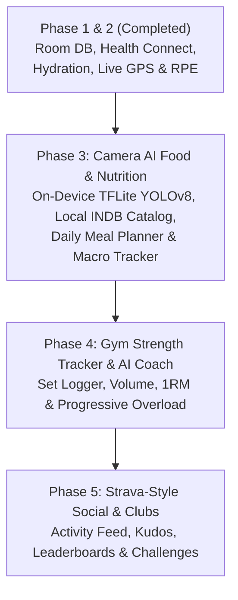

# CaloVelo Master Project Plans & Architecture Roadmap

> Comprehensive technical blueprint, feature matrix, UI design system, and development phases for **CaloVelo**.

---

## 1. Executive Summary & Core Vision
**CaloVelo** is an offline-first, AI-enhanced Android fitness, nutrition, and social workout app built with Kotlin, Jetpack Compose, Room, Health Connect, and on-device machine learning (LiteRT / TFLite).

---

## 2. Development Roadmap & Phased Execution

### Phase 1 & 2: Core Foundation & Live Workout Tracking (`COMPLETED`)
- [x] Room Persistence (`calovelo_db` v2 with migration logic).
- [x] Health Connect SDK integration (`HealthConnectManager`, `HealthRepositoryImpl`).
- [x] Hydration module with background WorkManager notifications & quick-add actions.
- [x] Foreground Service for live GPS workout recording with 25m accuracy filter & polyline encoding.
- [x] Post-workout RPE (Rating of Perceived Exertion) feedback bottom sheet.

### Phase 3: AI Camera Food Logging & Nutrition Suite (`NEXT UP`)
- [x] Dependencies & Manifest setup (CameraX, Coil, TFLite, Serialization).
- [x] Local Seeded Nutrition Catalog (`nutrition_seed.json` with 20+ Indian & global foods).
- [x] Room Database v3 (`FoodCatalogEntity`, `MealLogEntity`, explicit migration).
- [x] On-Device TFLite Vision Engine (`TfliteFoodDetector`, `BitmapPreprocessor` with graceful fallback).
- [ ] CameraX Viewfinder (`FoodScannerScreen`) with bounding box tags and gram sliders.

### Phase 4: Gym Strength Tracker, Exercise Guides & AI Analytics (`PLANNED`)
- [x] Gym Workout Database Schema (`ExerciseCatalogEntity`, `WorkoutExerciseEntity`, `ExerciseSetEntity`).
- [ ] **Rich Exercise Guides Database**: 
  - Comprehensive catalog of exercises and variations (e.g., Barbell Bench Press vs. Dumbbell Floor Press).
  - Detailed execution guides (form cues, target muscles, common mistakes) displayed before/during the exercise.
  - **3D Animated Graphics**: Embedded lightweight 3D animations (via Lottie or optimized WebGL/glTF assets) demonstrating perfect form and execution for each exercise.
- [ ] **Structured Workout Flow**: 
  - User selects exercise $\rightarrow$ Views Guide $\rightarrow$ Logs Sets (Weight/Reps/RPE) $\rightarrow$ Reviews form/fatigue $\rightarrow$ Proceeds to next.
- [ ] Advanced Stats: Total Session Volume, Estimated One-Rep Max (1RM) via Epley formula, PR badges.
- [ ] **AI Workout Generation & Analytics**: 
  - On-Device Progressive Overload engine (automatic weight/rep suggestions).
  - Deep analysis of historical performance to dynamically generate future workout plans based on recovery and goals.

### Phase 5: Strava-Style Social & Clubs (`PLANNED` - Supabase Backend)
- [ ] Migrate social backend architecture from Firebase to **Supabase** (PostgreSQL).
- [ ] Implement `supabase-kt` Kotlin SDK for Authentication, Storage (Photos), and Realtime Feeds.
- [ ] Activity Feed (Map route previews, photos, RPE badges, kudos).
- [ ] Club System (Create/Join clubs, complex relational queries for weekly distance/calorie leaderboards).
- [ ] Collaborative Challenges (Shared team goals executed via fast SQL aggregation).

---

## 3. UI Design System (Watch Order Engine & FreshKeep Inspired)

- **Theme & Aesthetics**: Material 3 Dark Mode with frosted glassmorphism (`#1E293B` on `#0F172A`), electric emerald (`#00E676`) and sunset orange (`#FF6D00`) neon accents.
- **Hero Dashboard**: Dual circular progress ring (Net Calories vs. Hydration) and horizontal weekly calendar strip.
- **Live Workout Tracking**: Immersive dark map with glowing neon green polyline and floating glassmorphic stats card.
- **Camera Scanner**: Animated target reticle viewfinder with real-time bounding box tags.
